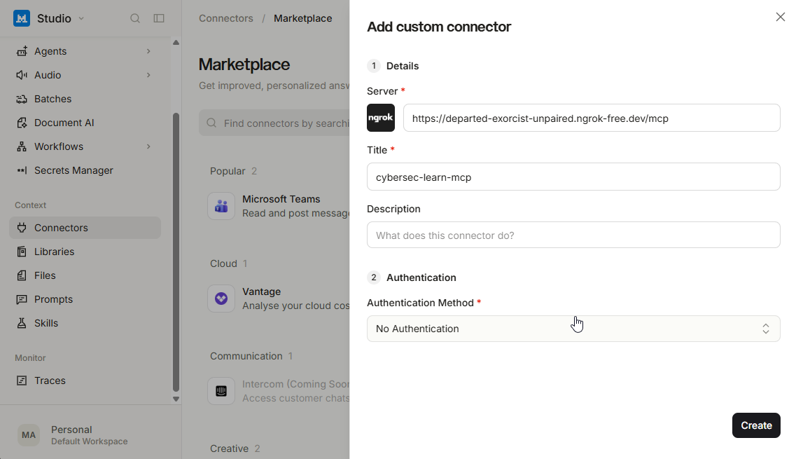
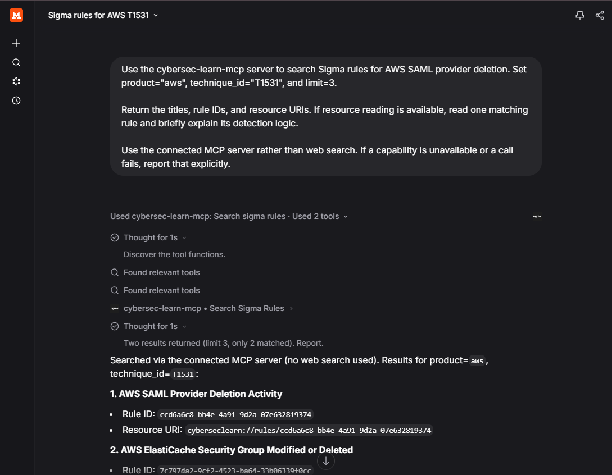

# CyberSec Learn MCP

CyberSec Learn MCP helps cybersecurity professionals search and discuss
[Sigma rules](https://sigmahq.io/)—portable detection rules for suspicious activity
in security logs—and connect them to [MITRE ATT&CK](https://attack.mitre.org/),
a knowledge base of attacker tactics and techniques.

Use an AI assistant to find relevant detections, understand their logic and required
telemetry, and explore the attacker behaviors they address. This can support threat
investigations, detection engineering, and learning.

## What you can do

- **Search detections:** `search_sigma_rules` supports semantic search, exact product
  and technique filters, and filter-only lookup with an empty query.
- **Read sources:** Sigma YAML at `cyberseclearn://rules/{rule_id}` and ATT&CK
  references at `cyberseclearn://techniques/{technique_id}`. Resource discovery starts
  at `cyberseclearn://catalog`.
- **Learn interactively:** `explain_sigma_rule`, `investigate_technique`, and
  `quiz_me_on_rule` provide reusable prompts. Prompt/resource support varies by client.

Example request:

> Search Sigma rules for AWS SAML provider deletion. Filter by product `aws` and
> technique `T1531`, and return up to 3 matches. Explain the matching rules.

| MCP setup | Sigma rule search |
| --- | --- |
|  |  |

## Data

- **SigmaHQ:** rules under the upstream repository's `rules/` directory. The reference
  snapshot contains **3,161 rules**. Search uses a local Chroma index with
  `BAAI/bge-small-en-v1.5` embeddings; full rule resources return the original YAML.
- **MITRE Enterprise ATT&CK 20.0:** **706 active techniques and sub-techniques**, with
  descriptions, procedure examples, mitigations, detection guidance, and references.
  These are looked up by ID; revoked and deprecated techniques are excluded.

The server provides reference material, not detection execution or proof of coverage.
Dataset versions, attribution, and licenses: [data/SOURCES.md](data/SOURCES.md).

## Setup

Run commands from the repository root. Install Python 3.12+,
[uv](https://docs.astral.sh/uv/getting-started/installation/), and Codex or Claude Code.

### Prepare the data

```bash
uv sync
git clone https://github.com/SigmaHQ/sigma.git data/upstream/sigma
git -C data/upstream/sigma checkout 05d1031f537e830b76da53bae2400c5814c89165
uv run python scripts/rag_sigma_index.py
uv run python scripts/prepare_attack.py
```

The first indexing run downloads the embedding model. ATT&CK preparation downloads
its source data. No hosted model API key is needed. To rebuild the Sigma index,
remove the generated `data/chroma/` directory and rerun the indexer.

### Start the server

The committed `.env` already supports local connections; no changes are needed.

```bash
uv run uvicorn app.server:app --host 127.0.0.1 --port 8000
```

### Connect a local client

To connect Codex or Claude Code to the MCP server locally, keep the server running
and run the appropriate command in another terminal:

```bash
# Codex
codex mcp add cybersec-learn-mcp --url http://localhost:8000/mcp

# Or Claude Code
claude mcp add --transport http cybersec-learn-mcp http://localhost:8000/mcp
```

Start a new session in your client and try either request:

> Use the cybersec-learn-mcp server to search for AWS SAML provider deletion.
> Filter by product `aws` and technique `T1531`, and return up to 3 matches with
> their titles and rule IDs.

> Use the cybersec-learn-mcp server to read ATT&CK technique `T1531` at
> `cyberseclearn://techniques/T1531` and explain it in plain language.

The first request tests search; the second tests resource access, where supported
by your client. This local setup does not require ngrok.

### Optional: connect remote clients with ngrok

To use the server from ChatGPT or Claude's desktop and web apps through a remote
MCP connection, expose it at a public HTTPS URL. These connections reach your
server from the provider's infrastructure, so they cannot use your `localhost`
address. ngrok forwards a public URL to your local server.

Install the [ngrok CLI for your OS](https://ngrok.com/download), create an account,
and configure your authtoken:

```bash
ngrok config add-authtoken YOUR_AUTHTOKEN
ngrok http 8000
```

Add the printed HTTPS origin (for example, `https://your-domain.ngrok-free.dev`) as
another line inside `.env`'s `ALLOWED_ORIGINS` value (without commas), then restart
the server.
Configure your MCP client with **Streamable HTTP** and
`https://your-domain.ngrok-free.dev/mcp`, with no authentication. Keep ngrok and the
server running while connected.

## Troubleshooting

Use MCP Inspector to inspect discovery responses and call tools, resources, and
prompts individually. It does not test the full workflow with a model.
Install [nvm](https://github.com/nvm-sh/nvm#installing-and-updating), then run from
the repository root to use the Node version pinned in `.nvmrc` and install and
launch Inspector on demand:

```bash
nvm install
nvm use
npx -y @modelcontextprotocol/inspector
```

Open the URL it prints, select **Streamable HTTP**, and connect to
`http://localhost:8000/mcp` (or your ngrok endpoint). Try `investigate_technique`
with technique `T1531` and product `aws`. Reconnect after a server restart if you
see “Session not found.” For “Invalid Host header,” check `ALLOWED_ORIGINS` and
restart the server.
